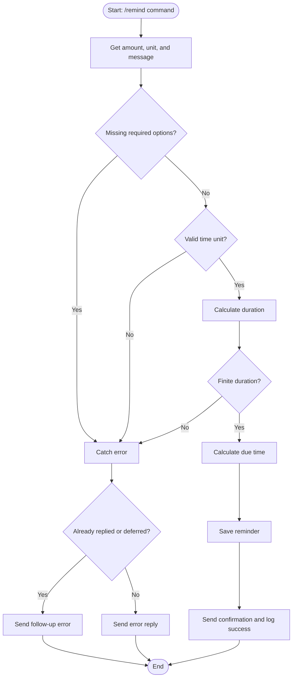
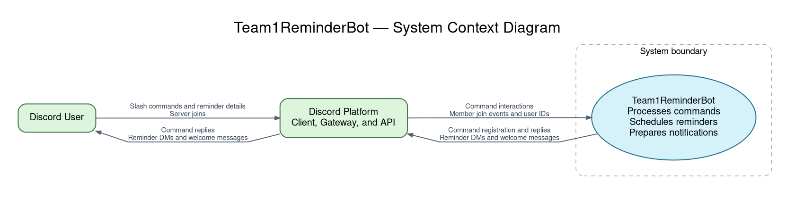
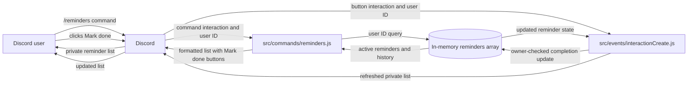

# Team1ReminderBot Architecture Guide

## Control Flow Graph – Reminder Command

### Explanation

This control flow graph shows how our Discord bot creates reminders. First, the bot gets the amount, time unit, and message from the user. It checks if any information is missing and if the time unit and duration are valid. If everything is correct, the bot calculates when the reminder is due, saves it, and sends a confirmation message. If something goes wrong, the bot catches the error and sends an error message to the user.

## System Context Diagram

This system context diagram shows the bot operating inside the system boundary while remaining connected to both the Discord user and the Discord platform. The user initiates reminder-related actions and receives responses through Discord, while the Discord Platform acts as the gateway that handles commands, events, and message delivery. The bot sits in the middle of this exchange and is responsible for processing commands and translating user requests into reminder behavior.

The architecture keeps concerns separated between the user-facing Discord experience and the bot’s internal logic. Discord handles the communication layer, including slash commands, gateway events, and DMs, while the bot interprets commands, calculates reminder timing, and prepares notifications. This arrangement makes the reminder workflow easier to understand and supports future growth, such as additional reminder features, event handling, or richer user interactions without tightly coupling the external interface to the bot’s core scheduling behavior.

  
## Data Flow Diagram – View and Complete Reminders

### Explanation
When a user runs /reminders, Discord sends the interaction and user ID to src/commands/reminders.js. The command requests that user's active reminders and history from src/helpers/reminderStore.js, formats the results, and replies privately with a Mark done button for each active reminder.

When the user clicks Mark done, src/events/interactionCreate.js routes the button interaction to the reminders command. The store checks that the reminder belongs to the clicking user, removes it from the active list, and records when it was marked done. The bot refreshes the private list to show the updated state. Reminder data is held in memory and is lost when the bot restarts.
