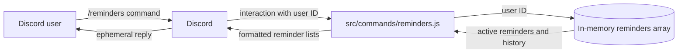

# Team1ReminderBot Architecture Guide

## Control Flow Graph – Reminder Command

### Explanation

This control flow graph shows how our Discord bot creates reminders. First, the bot gets the amount, time unit, and message from the user. It checks if any information is missing and if the time unit and duration are valid. If everything is correct, the bot calculates when the reminder is due, saves it, and sends a confirmation message. If something goes wrong, the bot catches the error and sends an error message to the user.
  
## Data Flow Diagram – View Reminders

### Explanation
When a user runs /reminders, Discord sends the interaction and the user's ID to src/commands/reminders.js. The command requests active reminders and reminder history for that user from src/helpers/reminderStore.js. The store filters its in-memory reminders array and returns the matching data. The command formats the results and replies ephemerally, so only that user can see the response.

Reminder data is held in memory while the bot is running and is lost when the bot restarts.
