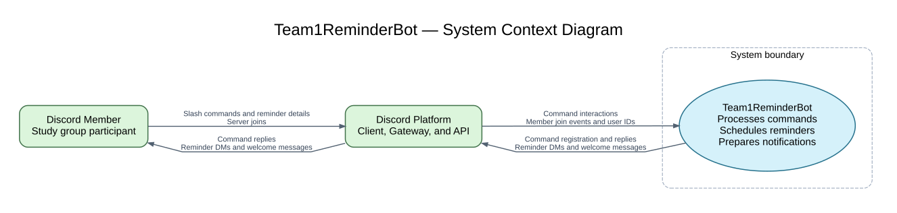

# Reminder Bot Architecture

## System purpose

Team1ReminderBot helps Discord study groups schedule personal reminders. Members can create reminders using a duration or a date, request early notifications, schedule daily or weekly reminders, and view upcoming reminders and reminder history. The bot also welcomes new server members and provides a command to check its connection latency.

## System context diagram

The diagram describes the current implementation. Team1ReminderBot is the system being developed. Discord members and the Discord platform are outside its boundary. Arrows identify the information exchanged between them.

**Figure 1. System context of Team1ReminderBot.** Members interact with the bot through Discord. Discord forwards commands and events to the bot and delivers the bot's responses and notifications to members.

## External participants

| Participant | Responsibility | Relationship to the bot |
| --- | --- | --- |
| Discord member | Provides reminder text, timing options, and repeat preferences; requests reminder lists or bot status; joins a server. | Uses Discord to submit requests and receive confirmations, reminder DMs, reminder lists, status replies, and welcome messages. |
| Discord platform | Provides the user interface, user identities, servers, channels, command interactions, and message delivery. | Forwards events to the bot and accepts command registrations, interaction replies, channel messages, and direct messages from the bot. |

## Information flows

| Direction in Figure 1 | Information exchanged | Example |
| --- | --- | --- |
| Member → Discord | Slash commands and their options, or a server join action. | `/reminder message:"Study for CSS360" amount:30 unit:Minutes` |
| Discord → Bot | Command name, command options, invoking user's ID, interaction context, and member join events. | A `/reminder` interaction containing the message, duration, and user ID. |
| Bot → Discord | Slash command definitions, confirmations, validation errors, reminder lists, status replies, reminder DMs, and welcome channel messages. | A direct message containing `Reminder: Study for CSS360` when a reminder becomes due. |
| Discord → Member | Displays command responses and delivers direct messages and server channel messages. | A private reminder confirmation followed by a reminder DM at the scheduled time. |

## System boundary and internal responsibilities

The system boundary includes the Node.js bot application, its command handlers, Discord event handlers, time calculations, scheduler, and in-memory reminder store. These are internal implementation details and therefore appear as a single system in Figure 1.

- **Command handling:** `src/commands/` implements reminder creation, recurring reminders, reminder lists, connection status, and welcome-message testing. `src/events/interactionCreate.js` routes slash command interactions to their handlers.
- **Time calculations:** `src/helpers/reminderTime.js` validates date and duration inputs and calculates early reminder times.
- **Reminder storage:** `src/helpers/reminderStore.js` keeps user IDs, reminder text, next scheduled times, repeat settings, and firing history in process memory.
- **Scheduling and delivery:** `src/helpers/reminderScheduler.js` checks for due reminders every 10 seconds and requests delivery through Discord. After a successful send, it records the scheduled occurrence and advances recurring reminders.
- **Discord connection and events:** `src/app.js` creates and connects the Discord client. The ready event registers slash commands and starts the scheduler. The member join event sends a welcome message to the configured server channel.

Discord's client, Gateway, API, user accounts, and message delivery infrastructure remain outside the bot's boundary. The `discord.js` library is part of the bot's implementation and provides access to that external platform. There is currently no external database or separate notification service.

## Example interaction

1. A member submits `/reminder` through Discord with reminder text and a duration or date.
2. Discord sends the command interaction and member identity to the bot.
3. The bot validates the timing options, stores the reminder in memory, and sends a private confirmation through Discord.
4. The scheduler detects that the reminder is due and asks Discord to send the member a DM.
5. After the send succeeds, the bot records the occurrence. A recurring reminder receives its next scheduled time; a one-time reminder is marked complete.

## Constraints and assumptions

- The bot must be running and connected to Discord to process requests and send reminders.
- Reminder data and history are lost when the bot process restarts because storage is in memory.
- Members must allow the bot to send DMs for reminder delivery to succeed. Failed sends are logged, and the reminder stays due for a later scheduler check.
- The scheduler checks every 10 seconds, so delivery can occur after the requested time. Network and Discord service delays can add further latency.
- Explicit date inputs are interpreted in Pacific time. The `/reminder` confirmation uses Discord timestamps, which Discord displays in each viewer's time zone.
- Deployment configuration supplies the bot token and the welcome channel name. Credentials are configuration, rather than a separate actor or service in the context diagram.

## Source references

- [Application entry point](src/app.js)
- [Command handlers](src/commands/)
- [Interaction routing](src/events/interactionCreate.js)
- [Startup and command registration](src/events/ready.js)
- [Welcome event handler](src/events/guildMemberAdd.js)
- [Reminder time calculations](src/helpers/reminderTime.js)
- [Reminder scheduler](src/helpers/reminderScheduler.js)
- [Reminder store](src/helpers/reminderStore.js)
